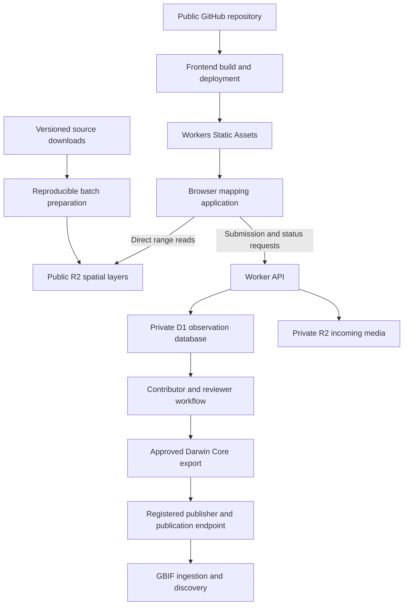

# Hosting and GBIF publishing plan

**Project:** Open Web-GIS application for a GBIF Ebbe Nielsen Challenge entry  
**Prepared:** 18 November 2026  
**Status:** Proposed architecture for external review; no infrastructure has been deployed or benchmarked  
**Currency:** USD, before taxes; published prices checked on the preparation date

## 1. Recommendation and review purpose

Build an open-source mapping application with two distinct workloads: predominantly static map delivery and a small transactional service for new observations. Use GitHub for source control, Cloudflare Workers Static Assets for the frontend, R2 Standard storage for prepared spatial layers and media, and a Worker API with D1 for submissions. Resolve the GBIF publishing arrangement in parallel with application development.

Use the Workers Free plan during the prototype if its limits are sufficient. For an initial public service, budget for the $5/month Workers Paid plan and its higher database and execution limits. This is a planning choice, rather than a claim that the free plan cannot handle the traffic.

Cloudflare is the proposed initial host because the workload suits inexpensive static delivery and object storage. The application, data formats, and build process should remain portable. Cloudflare is a proprietary hosting service; the openness of this project will come from its code, licenses, documentation, data provenance, and ability to run elsewhere.

The external reviewer should assess whether this design can meet the stated workload, whether the cost model captures the important variables, and whether the publication and operational arrangements are sufficient for launch. All performance targets below are proposed acceptance criteria, not measured results.

## 2. Requirements, assumptions, and unresolved inputs

| Item | Current basis | Planning implication |
|---|---|---|
| Priorities | Open, fast, and low cost; no provider preference | Favor standard formats, reproducible builds, and measured costs |
| Initial spatial data | Approximately 50–100 GB | Store large layers in object storage |
| Monthly users | Approximately 1,000 | No per-user hosting charge is assumed; identity pricing is separate |
| Map visits | Approximately 20,000/month | Model requests and transferred bytes per complete visit |
| Data change rate | Owner estimates 99% remains unchanged | Use versioned snapshots with periodic refreshes |
| Contributions | Users should submit new records through the app | Provide persistent storage, validation, review, and publication tracking |
| GBIF publishing organization | Not yet identified | Treat a confirmed publishing route as a launch dependency for GBIF publication |
| Contributor volume and media | Unknown | Use scenarios; measure during the pilot |
| Geography and peak concurrency | Unknown | Test multiple regions and agree a representative peak |
| Heavy spatial analysis | Not yet required | Keep GDAL processing and large joins in a batch pipeline initially |

For costing, 50–100 GB means the live, prepared serving dataset. Original downloads, historical releases, staging copies, media, and backups are additional unless the owner intended that figure to cover everything. Confirm this interpretation before procurement.

The 99% figure is a project assumption, not a guarantee about GBIF. Corrections, deletions, taxonomic changes, and new occurrences still require a refresh process. A map visit includes initial display and subsequent layer selection, panning, and zooming; it is not one HTTP request.

## 3. Proposed architecture



| Component | Responsibility | Initial implementation |
|---|---|---|
| Frontend | Map, filters, record display, contribution forms | TypeScript and MapLibre GL JS; static build output |
| Spatial delivery | Serve only the relevant tiles or raster blocks | R2 custom domain with HTTP range support and deliberate cache rules |
| Submission API | Authentication checks, input validation, writes, status lookup | Small Worker with a documented HTTP API |
| Transactional database | Observations, identifiers, revisions, review state, publication jobs | D1; bulk GBIF records stay outside this database |
| Media storage | Evidence files, approved public derivatives, publication archives | Separate private and public R2 buckets or clearly separated stores |
| Batch preparation | Download, transform, tile, summarize, validate, and release data | Versioned scripts on a suitable local machine or batch runner |
| Publishing integration | Deliver approved data to the GBIF network | Prefer a partner's hosted IPT; support other agreed dataset endpoints |

Cloudflare recommends Workers Static Assets for new projects. Ordinary asset requests are free, but invoking Worker code introduces a different usage model. Keep static frontend paths out of unnecessary Worker execution. [Deployment guidance][S01] [Asset billing][S02]

Illustrative addresses are `app.example.org`, `data.example.org`, and an API under the application domain. Actual domains and ownership remain to be selected. Configure a Cloudflare-managed zone for the R2 custom domain as required by the chosen setup, preserving existing website and email DNS records during any change. A production R2 endpoint should use a custom domain; `r2.dev` is a development endpoint with rate limits. [R2 public access][S03]

## 4. Spatial data preparation and delivery

### 4.1 Versioned, reproducible releases

Obtain a suitably scoped GBIF download rather than repeatedly paging through occurrence search results to reconstruct the full dataset. Preserve the download DOI, query, download date, source files needed for rebuilding, transformation parameters, and checksums. GBIF's download API provides asynchronous downloads and associated citation information. [GBIF downloads][S04]

Each map release should have an immutable version directory and a small manifest that records source versions, spatial coverage, counts, licenses, attribution, and layer URLs. Build into a new directory, validate it, and update the manifest only after completion. Retain the previous release so rollback is a manifest change. Do not depend on overwriting a large archive while browsers are reading its byte ranges.

Proposed initial refresh policy: inspect for relevant updates weekly and publish a refreshed snapshot monthly, with an exceptional rebuild for important corrections or withdrawals. Confirm the cadence with the scientific owner. Do not assume a reliable incremental-change feed exists for every source; the first pipeline should support a complete scoped rebuild.

### 4.2 Vector and raster formats

Use PMTiles for suitable vector layers, including occurrence visualization and reference boundaries. Choose zoom ranges and generalization rules that prevent dense areas from overwhelming the browser. Broad-scale occurrence display should use appropriate aggregation; preserve record-level access and source data for detailed inspection.

Use tiled, overview-equipped COGs when browser raster access is appropriate. MapLibre requires a compatible COG integration; hosting a TIFF alone is insufficient. Validate the actual coordinate system, compression, bands, nodata values, and mobile decoding behavior. If browser decoding performs poorly, evaluate prepared raster tiles before adding a live raster-processing service. [MapLibre COG example][S05]

Generalized display geometry and aggregated tiles are presentation products. Analyses requiring original coordinates, geometry, or raster precision must use appropriate source data. Document that distinction in the application's methods.

Define the supported filters and analyses before accepting the static design. Precomputed layers can support many display filters and prepared summaries, but arbitrary polygon counts, buffers, spatial joins, or unrestricted combinations may need additional indexing or computation. A low data change rate does not establish that every query can be answered cheaply. Confirm these interactions in the pilot.

For record inspection, either retain sufficient snapshot fields in accessible prepared products or provide a documented lookup strategy. If current GBIF API details are used, distinguish them from the versioned map snapshot. Core map display should continue during an external record-detail service outage, with the affected detail view explaining its availability.

### 4.3 Range requests, CORS, and caching

Large map archives belong in R2. Workers Static Assets has a 25 MiB per-file limit and does not natively honor byte-range requests with partial responses. Its ordinary response to a range request is the full asset. [Workers limits][S06] [Range behavior][S02]

PMTiles depends on correct range and cross-origin behavior. Configure GET/HEAD access and the headers needed by the selected client, including handling of `Range`, `If-Match`, and exposed `ETag`/range response metadata where applicable. Verify this using browser requests from the production and preview origins. [PMTiles storage guidance][S07] [R2 CORS][S08]

Use long-lived cache headers on immutable public archives, short caching or revalidation on the release manifest, and private/no-store responses for personal submission data. Explicitly make `.pmtiles` and other intended public layer paths eligible for CDN caching. Do not assume unfamiliar extensions are cached automatically.

Cloudflare's ordinary CDN cacheable-file ceiling is 512 MB on Free, Pro, and Business plans. Large R2 files can still be served, but small range requests do not by themselves establish that a multi-gigabyte archive is efficiently cached at the edge. [CDN behavior and limits][S09]

Test both warm and cold delivery for the largest planned files. If results are poor, first evaluate regional/thematic partitions and smaller prepared assets. A tile-serving Worker is a later option when justified by measurements; it adds requests, cache logic, and another component to maintain. Do not proxy every map request through the submission API.

## 5. Observation collection and GBIF publication

### 5.1 Collection model

Give each observation a stable project identifier suitable for use as `occurrenceID`. Store original contributor input, the interpreted values, revision history, attribution, license choice, evidence links, and workflow status. Keep the observation identifier stable when a record is corrected.

Capture the appropriate Darwin Core fields for the agreed record type: taxon/name information, event date, basis of record, coordinates, datum, uncertainty, locality, observer, identification information, and supporting evidence as relevant. Preserve verbatim values alongside normalized values. Define required fields with the eventual publisher rather than treating every possible Darwin Core term as mandatory.

Separate review status from publication status. Suggested values include `draft`, `submitted`, `needs_changes`, and `approved` for review; and `not_exported`, `exported`, `published_by_provider`, `indexed_by_gbif`, and `publication_error` for delivery. A successful form submission must not be presented as confirmation of GBIF indexing.

Pending records should be visible to their contributor and authorized reviewers. Any public overlay should contain only records approved for that visibility and should be labeled accurately. Reconcile exported records with later GBIF versions using stable source identifiers so a local overlay and a GBIF snapshot do not display the same occurrence twice.

### 5.2 Publishing route

GBIF's normal ingestion model consumes datasets supplied through publishing organizations. Its public occurrence API is not a general insert endpoint for arbitrary observations. IPT is a common publishing mechanism, and custom systems can also serve standards-compliant archives from a web server. [GBIF publication model][S10]

Preferred route: establish a relationship with a registered publisher and request access to an existing IPT in the relevant country or community. The IPT manual recommends hosted arrangements to reduce operating effort. A dataset discoverable through GBIF must have the required organizational affiliation. [IPT prerequisites][S11]

Begin with a documented, manually supervised export/import process. Automate delivery only after the partner confirms supported import mechanisms, update schedules, validation rules, and responsibility for failed publications. Do not assume every IPT exposes a record-writing API suitable for the app.

A second route is a registered publisher using a custom Darwin Core Archive endpoint, potentially served from R2. Validate the complete archive, metadata, registration, and update workflow before adopting this route. A third route is operating an IPT server, which introduces separate server maintenance and cost. An always-on IPT server is not inherent to the recommended application hosting design.

Publication acceptance requires an end-to-end demonstration with an authorized publisher: submit, review, export, publish, confirm GBIF discovery, and process a correction while retaining the source identifier. The partner agreement should identify who manages updates, withdrawals, licensing, and continuity of the dataset endpoint. No GBIF publishing partner has yet been arranged.

Keep published archive and media URLs stable for as long as their records reference them. Map-release cleanup rules must not delete objects still used by a published dataset. Check that a proposed hosting or publisher migration preserves those references and the organization's ability to maintain the dataset.

## 6. Backend, database, and access controls

Use the database for the relatively small volume of project contributions and workflow metadata. D1 is not the proposed store for the entire 50–100 GB map dataset, nor a substitute for PostGIS when complex spatial computation is required. Keep database access behind the API, use indexed queries, paginate results, and limit query scope.

Relevant current database allowances are:

| Metric | Workers Free / D1 | Workers Paid / D1 |
|---|---:|---:|
| Maximum individual database | 500 MB | 10 GB |
| Included storage across the account | 5 GB | 5 GB |
| Included row reads | 5 million/day | 25 billion/month |
| Included row writes | 100,000/day | 50 million/month |
| Point-in-time recovery window | 7 days | 30 days |

These are different limits: a free account's 5 GB allowance does not make a single free database 5 GB. Row scans and index maintenance affect consumption; one observation is not necessarily one billed write. [D1 limits][S12] [D1 pricing][S13]

Select a mature authentication implementation after confirming contributor access needs. Prefer a standard identity integration with a replaceable adapter. Require stronger authentication for reviewers and administrators. Identity, verification email, and account recovery costs are not yet included in the hosting estimate.

Enforce ownership and reviewer permissions server-side. Apply input validation, upload size/type limits, request throttling, and idempotency to avoid duplicate submissions on retries. Keep incoming media private; create public derivatives only when authorized for release. Use scoped, short-lived upload access where appropriate and prevent permanent storage credentials from reaching browsers.

Define handling for sensitive species locations and personal information before enabling public contributions. Public mapping may need generalized coordinates while restricted reviewers retain originals. Pending records, private media, authentication material, and database backups must never enter the public GitHub repository or a public bucket.

## 7. Cost model

### 7.1 Published rates and calculation basis

R2 Standard currently includes 10 GB-month, 1 million Class A operations, and 10 million Class B operations monthly. Excess storage is $0.015/GB-month; excess Class A operations are $4.50/million and Class B operations $0.36/million. Outgoing R2 bandwidth has no egress charge. Usage is rounded to billing units. [R2 rates][S14]

For the scenarios below:

```text
S = average billable storage in GB-month
B = monthly Class B operations reaching R2
A = monthly Class A operations

Storage cost = max(0, ceil(S) - 10) × $0.015
Read cost    = ceil(max(0, B - 10,000,000) / 1,000,000) × $0.36
Write cost   = ceil(max(0, A - 1,000,000) / 1,000,000) × $4.50
```

The model assumes one shared allowance across project usage, Standard storage, no other account consumption, and writes within the allowance. Reads include metadata requests and retries, not just visible tiles. Browser/CDN hits that avoid R2 reduce this count.

### 7.2 Map traffic sensitivity

Calculated at 20,000 visits/month; the read counts are scenarios, not predictions:

| R2 reads per visit | Monthly reads | R2 total: 50 GB | R2 total: 100 GB | 100 GB plus $5 Workers subscription |
|---:|---:|---:|---:|---:|
| 100 | 2 million | $0.60 | $1.35 | $6.35 |
| 500 | 10 million | $0.60 | $1.35 | $6.35 |
| 1,000 | 20 million | $4.20 | $4.95 | $9.95 |
| 2,000 | 40 million | $11.40 | $12.15 | $17.15 |
| 5,000 | 100 million | $33.00 | $33.75 | $38.75 |

The final column assumes API/database consumption remains within the paid plan's included usage. It excludes all items in section 7.4. This table is calculated from the cited rates and does not represent a fixed hosting quotation.

### 7.3 API and submission workload

Workers Free permits 100,000 dynamic requests/day and 10 ms CPU per invocation. Workers Paid starts at $5/month and includes 10 million requests and 30 million CPU milliseconds monthly; excess requests are $0.30/million and excess CPU $0.02/million milliseconds. [Workers pricing][S15]

As an illustration, 500,000 monthly API calls averaging 3 ms CPU consume 1.5 million CPU milliseconds and fit those paid allowances. This is a model input, not a measured benchmark. Direct R2 reads are separate from API invocations. Routing all spatial reads through a Worker would require adding those invocations and their CPU use to the model.

Contributor count does not establish media volume. An illustrative 1,000 new observations/month with two 2 MB photos each adds about 4 GB/month, or 48 GB after a year if retained. Thumbnails, originals, backups, and publication copies add further capacity. Database sizing must include revisions, indexes, and audit history.

### 7.4 Costs outside the base table

Budget separately for retained map releases, source archives, staging, independent backups, new media, domain renewal, identity/email services, paid basemaps, monitoring, batch computing, and any separately operated publishing server. Developer time, moderation, scientific review, and publishing support are operating costs even when a partner supplies infrastructure.

Initial recurring infrastructure planning allowance: **$10–$25/month** for moderate reads, bounded retention, and a small paid backend. This is an engineering budget with contingency, not a cap or complete project operating budget. The high-read scenario already exceeds it. Confirm the unknown services and pilot usage before presenting a total cost commitment.

Alert on forecast spend and unexpected operations. Distinguish notifications from enforceable spending controls: a Worker spending limit does not cap R2 storage or operation charges. Document which service would stop and what users would experience before enabling any automatic cutoff.

## 8. Alternatives and reasons for the initial choice

| Alternative | Where it is strong | Important tradeoff for this project |
|---|---|---|
| GitHub Pages + R2 | Free static frontend close to the public source repository | Still needs a submission backend and external large-data storage |
| GitHub Pages + Bunny Storage/CDN | Portable static delivery with bandwidth-based pricing and no CDN request fee | Adds delivered-byte charges and needs a backend elsewhere |
| S3 + CloudFront | Mature hosting and a path toward broader AWS services | More configuration; origin/storage/API charges still need modeling |
| Hostinger managed cloud | Managed website hosting, including surrounding WordPress content | Dataset capacity and renewal price matter; complex backend capabilities need verification |
| Hostinger VPS | Control over PostGIS, GDAL, IPT, or a custom tile server | Server administration, patching, recovery, and capacity planning become project work |

GitHub Pages is suitable for a small frontend, but its published site limit is 1 GB and its soft bandwidth allowance is 100 GB/month. It cannot host the proposed 50–100 GB dataset as a Pages site. [GitHub limits][S16]

Bunny's single-region Standard storage is $0.01/GB-month with a $1 storage minimum. Standard CDN delivery is $0.01/GB in North America/Europe, with different regional rates; Volume delivery starts at $0.005/GB using fewer locations. At 100 GB stored and 2 TB delivered, an illustrative total is $21/month on Standard NA/EU delivery or $11/month on Volume. These figures exclude a submission backend. [Bunny storage][S17] [Bunny CDN][S18]

CloudFront Pro currently costs $15/month, with a 50 TB delivery allowance, 10 million requests, and credits corresponding to 50 GB of S3 storage. It has no delivery overage charges under the plan, but extra origin storage and other AWS services can still cost more. Confirm required cache/header features for the GIS client before selecting a flat-rate tier. [CloudFront pricing][S19]

Hostinger Cloud Startup advertises 100 GB at $7.99/month equivalent for 48 months, renewing at $25.99; the initial commitment is $383.52. VPS KVM 4 advertises 200 GB and 16 TB bandwidth at $12.99/month equivalent for 24 months, renewing at $28.99; initial commitment is $311.76. A 100 GB dataset needs headroom beyond a nominal 100 GB plan. Offers and existing account entitlements vary. [Hostinger cloud/web pricing][S20] [Hostinger VPS][S21]

The proposed Cloudflare design is an initial economic and operational choice, not a claim of universally fastest delivery. If the pilot shows unfavorable cold-range performance or an extremely high request count relative to bytes delivered, compare Bunny and AWS using the same recorded workload.

## 9. Openness, portability, and exit plan

Publish the frontend, API domain logic, schema migrations, preprocessing scripts, dependency lockfiles, and deployment instructions under explicit open-source licenses. Retain source data licenses and attribution; do not relabel third-party data under the software license. Supply a small reusable demonstration dataset so a reviewer can reproduce the application without obtaining the full 100 GB.

Keep layer URLs in configuration and serve standard PMTiles, COG, CSV/GeoJSON, and Darwin Core products as appropriate. Avoid hard-coding provider credentials or account identifiers into scientific logic. Document basemap, font, glyph, and sprite dependencies and their terms and costs.

| Dependency | Expected migration work |
|---|---|
| Static frontend | Deploy the same build output to another static host |
| R2 data | Copy objects with S3-compatible tooling; change configured URLs and CORS |
| Worker API | Adapt request handling and bindings to another runtime |
| D1 | Export SQL, restore into a compatible database, and adapt the database access layer |
| CDN/DNS configuration | Recreate cache, range, header, and domain settings |
| Identity integration | Move credentials/configuration and verify account continuity |

D1 supports database export, which should be tested against a local SQLite restoration. Exportability does not eliminate runtime and SQL compatibility work. [D1 import/export][S22]

An exit exercise should demonstrate the frontend and a small archive on an alternative host, plus API/database operation outside Cloudflare. A fully open-source hosting platform is a different requirement from an open-source, portable application; if it becomes mandatory, reassess toward a maintained server deployment.

## 10. Deployment, maintenance, and recovery

Use separate development, staging, and production databases and buckets. Preview deployments must use synthetic or explicitly approved public data. Production publishing credentials belong only in restricted runtime or release environments.

Keep code deployment separate from large-data preparation. Run frontend checks and builds in CI. Start large spatial builds on a machine with measured disk, memory, and runtime capacity; do not assume a normal CI runner can accommodate the download and intermediate files. Record resource use during the pilot before selecting a paid batch service.

Deploy data to new versioned keys, run format and HTTP checks, then switch the manifest. Roll back frontend and data versions independently. Use backward-compatible schema migrations and test them against a restored database before production.

Assign named owners for infrastructure/billing, scientific data stewardship, publication, and incident response. The same person may initially hold several roles, but access recovery must not depend on a single unmanaged account.

Use D1 point-in-time recovery and independent encrypted exports. Proposed starting retention is seven daily, four weekly, and three monthly database backups, subject to the final privacy/deletion policy. Copy irreplaceable media and its manifest independently; keep reproducible source material or an independent copy for map releases. A second bucket in the same account is insufficient protection against complete account loss.

Proposed recovery objectives are at most 24 hours of lost accepted submissions and restoration of core service within one business day. These are targets requiring a tested off-provider backup process, not vendor guarantees. Perform a restore exercise before launch and quarterly thereafter; adjust targets if the operating team cannot support them.

Monitor map availability, API errors, database scans/size, R2 operations, client failures, backup age, publication lag, and monthly spend. On failure, the public map should remain usable when the submission API is unavailable, while forms clearly report failure and avoid implying that unsaved work was accepted.

## 11. Pilot validation and acceptance criteria

Use a dense occurrence region, representative boundaries, and the largest intended raster. Test a complete user journey: open map, change layers, pan/zoom, inspect a record, submit an observation with evidence, review it, and export it. Record actual usage rather than extrapolating from a single initial page load.

| Check | Proposed acceptance evidence |
|---|---|
| Range delivery | Correct 206 responses, byte offsets, response length, and CORS from deployed browser origins |
| Initial map | Target p75 useful-map display within 3 seconds on a defined 10 Mbps / 100 ms test connection |
| Exploration | Stable interaction on an agreed midrange mobile device without loading entire large archives |
| Large archives | Cold/warm results measured above and below the ordinary CDN cache-size threshold |
| API | Target p95 lightweight status/write response within 1 second, excluding media transfer and external services |
| Peak load | Initial exercise with 25 active map sessions and five simultaneous submitters; revise after geographic/peak inputs are known |
| Cost | Observed operations/bytes/CPU used to replace scenario assumptions and identify a high-usage case |
| Record integrity | Retry-safe submission, stable identifiers, complete revision history, and no double display after reconciliation |
| Publication | Authorized end-to-end dataset publication and later correction confirmed through GBIF |
| Recovery | Database and media restored independently and rollback demonstrated |
| Portability | Small deployment reproduced outside the primary provider |

Test failures should drive specific changes: smaller partitions for range/cache problems, fewer initial layers for slow first display, indexed/paginated database queries for high scan counts, and a separate batch/server service for genuinely heavy computation. No performance advantage over another provider is claimed before this exercise.

## 12. Delivery sequence and external review decisions

1. **Confirm scope and stewardship.** Resolve whether 50–100 GB includes source/history/backups, contributor/media volumes, target regions, record types, data licenses, and ownership. Start publisher discussions.
2. **Run a spatial hosting pilot.** Build a representative immutable release, test R2 range/CORS/cache behavior, benchmark the browser, and measure request/byte costs. Compare another provider if the result is weak.
3. **Build the static application and repeatable release process.** Establish repository documentation, local execution, sample data, CI, staging, manifest switching, and attribution.
4. **Implement submissions and review.** Add identity, database, private uploads, validation, idempotency, status tracking, exports, and recovery. Validate permissions and failure behavior.
5. **Connect publication.** Agree the publisher/import process, prove GBIF ingestion and record correction, and reconcile local versus indexed records. Until then, label records awaiting publication accurately.
6. **Launch and measure.** Confirm owners, recovery evidence, live monitoring, and an updated budget. Revisit traffic, media retention, and publication lag after the first month.

The reviewer is asked to resolve these decisions explicitly:

| Decision | Proposed default | Evidence or owner needed |
|---|---|---|
| Provider and architecture | Cloudflare static delivery plus a small backend | Pilot measurements and portability demonstration |
| Query and analysis scope | Prepared display filters and summaries | Confirm arbitrary spatial queries before excluding a spatial backend |
| Public backend plan | Workers Paid at $5/month | Expected database size, CPU, and operational needs |
| Raster strategy | Browser COGs where they perform adequately | Largest-raster and mobile tests |
| Archive partitioning | Partition where it improves measured delivery | Cold-cache and regional results |
| Publishing route | Existing registered publisher/hosted IPT | Named partner and confirmed update process |
| Identity and contributor access | Replaceable standard integration | Access model, email flow, and cost |
| Privacy and location release | Private intake with reviewed public derivatives | Scientific steward and data policy |
| Recurring budget | $10–$25/month initial infrastructure allowance | Complete retention/media/service assumptions |
| Recovery and maintenance | Daily independent protection; assigned owners | Restore exercise and operating commitment |
| Need for a VPS/PostGIS | Add when a demonstrated feature needs it | Workload beyond static products and simple transactional queries |

This document requests architectural review. No provider account, payment commitment, production deployment, publishing registration, or contact with an external organization has been made as part of preparing it.

## Sources

Links are primary provider, GBIF, or project documentation checked on 18 November 2026. Rates, limits, and product names can change; confirm applicable account terms when implementing.

[S01]: https://developers.cloudflare.com/workers/best-practices/workers-best-practices/
[S02]: https://developers.cloudflare.com/workers/static-assets/billing-and-limitations/
[S03]: https://developers.cloudflare.com/r2/buckets/public-buckets/
[S04]: https://techdocs.gbif.org/en/data-use/api-downloads
[S05]: https://maplibre.org/maplibre-gl-js/docs/examples/add-a-cog-raster-source/
[S06]: https://developers.cloudflare.com/workers/platform/limits/
[S07]: https://docs.protomaps.com/pmtiles/cloud-storage
[S08]: https://developers.cloudflare.com/r2/buckets/cors/
[S09]: https://developers.cloudflare.com/cache/concepts/default-cache-behavior/
[S10]: https://techdocs.gbif.org/en/data-publishing/
[S11]: https://ipt.gbif.org/manual/en/ipt/latest/how-to-publish
[S12]: https://developers.cloudflare.com/d1/platform/limits/
[S13]: https://developers.cloudflare.com/d1/platform/pricing/
[S14]: https://developers.cloudflare.com/r2/pricing/
[S15]: https://developers.cloudflare.com/workers/platform/pricing/
[S16]: https://docs.github.com/en/pages/getting-started-with-github-pages/github-pages-limits
[S17]: https://bunny.net/pricing/storage/
[S18]: https://bunny.net/pricing/cdn/
[S19]: https://aws.amazon.com/cloudfront/pricing/
[S20]: https://www.hostinger.com/pricing
[S21]: https://www.hostinger.com/vps-hosting
[S22]: https://developers.cloudflare.com/d1/best-practices/import-export-data/
